# Doctor Tracker

Doctor Tracker is a secure admin portal for managing doctors and their patients. Admins sign in, add doctors, assign and remove patients, and search, filter and paginate every list. A live dashboard turns the data into charts: totals, patients per doctor, top conditions and growth over time. It is a standalone Next.js client talking to a standalone Express API backed by MongoDB, with indexed queries and motion-polished, responsive UI.

**Stack:** Next.js 14 (App Router) · Express · MongoDB + Mongoose · TanStack Query · Recharts · Framer Motion · Docker

## Setup guide

Prerequisites: Node 20+ and Docker Desktop.

### Option A: everything in Docker

```bash
cp backend/.env.example backend/.env
docker compose up --build
```

Open http://localhost:3000 and sign in with `ADMIN_EMAIL` / `ADMIN_PASSWORD` from `backend/.env` (defaults: `admin@example.com` / `Admin@12345`). The admin user is created automatically on first boot.

Load demo data (24 doctors, 400 patients):

```bash
docker compose exec backend npm run seed
```

### Option B: run services with npm (hot reload)

```bash
docker compose up -d mongo                # MongoDB only
cp backend/.env.example backend/.env      # MONGODB_URI already points to localhost
cp frontend/.env.example frontend/.env.local
cd backend  && npm install && npm run seed && npm run dev      # http://localhost:4000
cd frontend && npm install && npm run dev                      # http://localhost:3000
```

### Environment variables

| File | Variable | Purpose |
| --- | --- | --- |
| `backend/.env` | `MONGODB_URI` | Mongo connection string (Docker, local or Atlas) |
| | `JWT_SECRET` | Signs session tokens. Use a long random value in production |
| | `CORS_ORIGIN` | Comma-separated allowed frontend origins |
| | `ADMIN_EMAIL`, `ADMIN_PASSWORD` | Admin account auto-created on first boot |
| | `DEMO_MODE` | `true` enables `POST /api/auth/demo` (one-click demo sign-in). Set `false` for real use |
| `frontend/.env.local` | `BACKEND_URL` | Where the Next.js `/api` rewrite forwards requests |
| | `NEXT_PUBLIC_DEMO_MODE` | `true` shows the "Quick sign in as demo admin" button on the login page |

See `backend/.env.example` and `frontend/.env.example`.

## System architecture

```
Browser ──► Next.js (Vercel / :3000)
              │  middleware: no session cookie → /login
              │  rewrite: /api/* ──────────────┐
              ▼                                 ▼
        React pages (TanStack Query)     Express API (Render / :4000)
                                          helmet · cors · rate-limit
                                          zod validation → controllers
                                                  │ Mongoose
                                                  ▼
                                        MongoDB (Atlas / Docker)
```

- **Auth flow:** `POST /api/auth/login` verifies a bcrypt hash and sets an **httpOnly** JWT cookie. Every other route sits behind `requireAuth`. The Next.js middleware only checks that the cookie exists; the API is the real gatekeeper.
- **Data flow:** pages call `/api/...` on their own origin. Next.js rewrites those requests to the Express server, so the browser never makes a cross-site call.
- **Environments:** local = Docker Compose (`mongo`, `backend`, `frontend`). Live = Vercel (frontend), Render (API, see `render.yaml`) and MongoDB Atlas (database).

### API documentation (Swagger UI)

Interactive docs for every endpoint, with "Try it out":

| Where | URL |
| --- | --- |
| Local backend | http://localhost:4000/api-docs |
| Local via frontend | http://localhost:3000/api-docs |
| Live (Render) | `https://<your-service>.onrender.com/api-docs` |
| Live (Vercel) | `https://<your-app>.vercel.app/api-docs` (proxied to the backend) |

Raw spec: `/api-docs.json`. To call protected endpoints, run `POST /api/auth/login` (or `/api/auth/demo`) first; the session cookie is set automatically.

### REST API

| Method | Route | Description |
| --- | --- | --- |
| POST | `/api/auth/login` · `/logout` | Sign in / out |
| POST | `/api/auth/demo` | One-click demo sign-in (only when `DEMO_MODE=true`, otherwise 404) |
| GET | `/api/auth/me` | Current user |
| GET | `/api/dashboard/stats?days=30` | Totals, timeline, patients per doctor, conditions |
| GET / POST | `/api/doctors` | List (search, filters, pagination) / create |
| GET / DELETE | `/api/doctors/:id` | Detail / delete (cascades to patients) |
| GET / POST | `/api/doctors/:id/patients` | A doctor's patients / add a patient |
| GET | `/api/patients` | List (search, condition, gender, doctor, dates, pagination) |
| PATCH / DELETE | `/api/patients/:id` | Edit / delete |

List endpoints accept `page`, `limit`, `q`, `from`, `to`, `sort` and return `{ data, meta: { total, page, limit, totalPages } }`. Invalid input returns `400` with per-field errors.

## Technical decisions

### 1. Index-backed prefix search on lowercased fields (instead of `$text` or unanchored regex)

An unanchored case-insensitive regex (`/ali/i`) forces a collection scan, and `$text` only matches whole words, so typing "card" would not find "Cardiology". Instead each document stores lowercase copies of searchable fields (`nameLower`, `specializationLower`, `conditionLower`, …), set by a Mongoose hook. Search runs an anchored regex (`^card`) on those fields, which MongoDB can serve from a B-tree index. Filters use compound indexes such as `{ doctor: 1, createdAt: -1 }` and `{ conditionLower: 1, createdAt: -1 }`, so filter + sort + paginate stays on an index. Trade-off: a little extra storage, and matching starts at the beginning of a field.

### 2. Same-origin `/api` proxy with an httpOnly cookie (instead of cross-site tokens)

The frontend (Vercel) and API (Render) live on different domains. Calling the API directly would need `SameSite=None` third-party cookies, which browsers increasingly block, or tokens stored in `localStorage`, which any XSS can read. Instead Next.js rewrites `/api/*` to the Express server, so the JWT cookie is **first-party, httpOnly and `SameSite=Lax`**. This removes CORS from the browser path and keeps the token out of JavaScript. Trade-off: API traffic passes through Vercel's rewrite layer.

### Other choices

- **TanStack Query** for server state: caching, request de-duplication, `keepPreviousData` for flicker-free pagination, targeted invalidation after mutations.
- **Dashboard aggregation** runs as a handful of `$group` pipelines in parallel (`Promise.all`); patient counts for a doctors page come from one grouped query rather than N+1 lookups.
- **Re-render control:** debounced search, memoised table rows and charts, list state kept in one `useListFilters` hook.
- **Motion** uses Framer Motion with `reducedMotion="user"`, so the OS accessibility setting is respected.

## Deployment

1. **MongoDB Atlas:** create a free M0 cluster, add a database user, allow network access (`0.0.0.0/0` for Render's free tier), and copy the `mongodb+srv://…/doctor_tracker` string.
2. **Render:** New → Blueprint (uses `render.yaml`), or a Web Service with root `backend`, build `npm install --omit=dev`, start `npm start`. Set `MONGODB_URI`, `CORS_ORIGIN` (your Vercel URL), `ADMIN_EMAIL`, `ADMIN_PASSWORD`. `JWT_SECRET` is generated.
3. **Vercel:** import the repo, set the root directory to `frontend`, and add `BACKEND_URL=https://<your-render-service>.onrender.com`.

The free Render tier sleeps when idle, so the first request after a pause can take about 30 seconds.

## Mobile app (Flutter)

**[Download the Android APK](https://github.com/saad125862/doctor-tracker/releases/latest/download/doctor-tracker.apk)** (sideload; see the [release page](https://github.com/saad125862/doctor-tracker/releases/latest)).

A native Android / iOS client lives in [`mobile/`](mobile/). It uses the same REST API and the same Midnight Lime theme as the web app: login (with quick demo sign-in), dashboard analytics, doctors with search and filters, doctor profile with patients, and a patients list with edit and delete.

```bash
cd mobile
flutter pub get
flutter run        # talks to the live API by default; see mobile/README.md to point it elsewhere
```

<table>
  <tr>
    <td>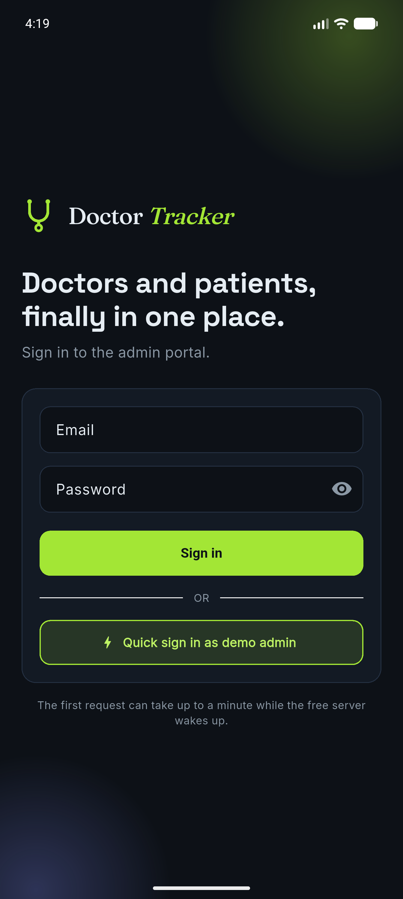</td>
    <td>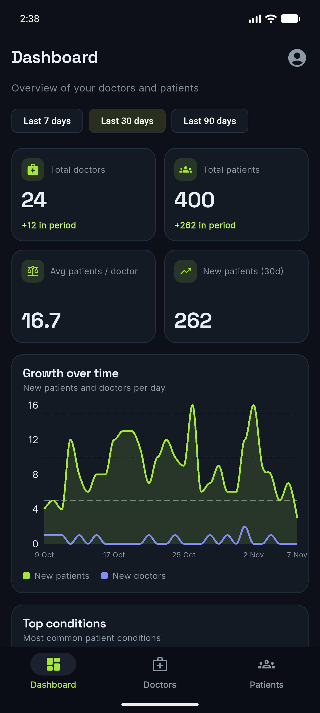</td>
    <td>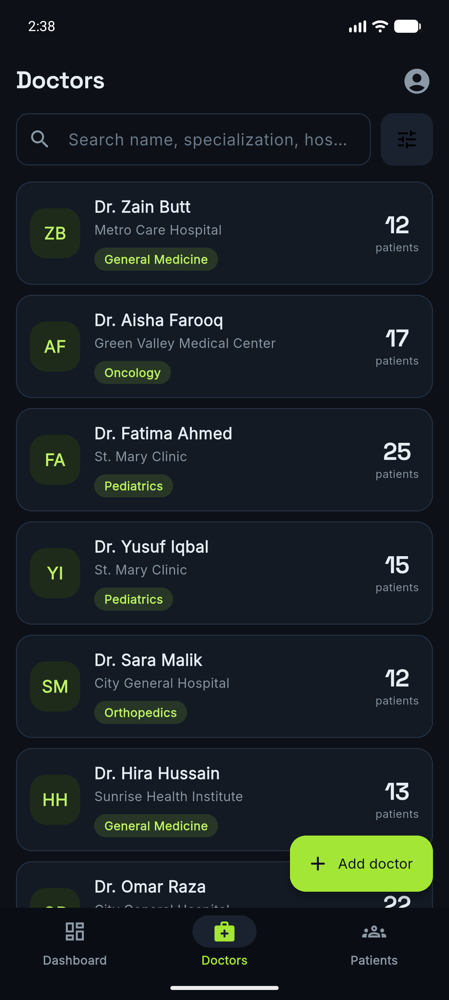</td>
  </tr>
  <tr>
    <td>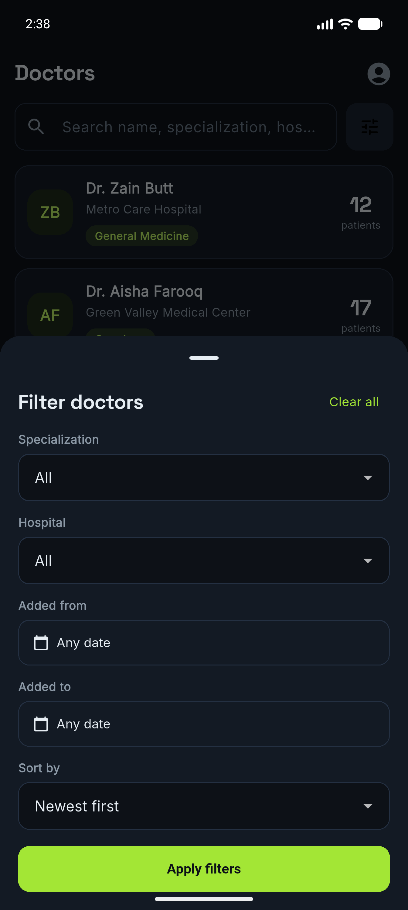</td>
    <td>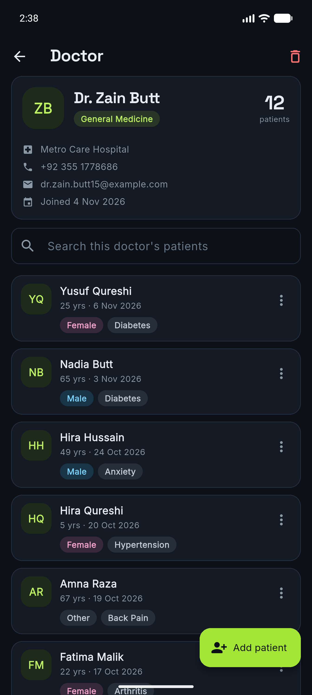</td>
    <td>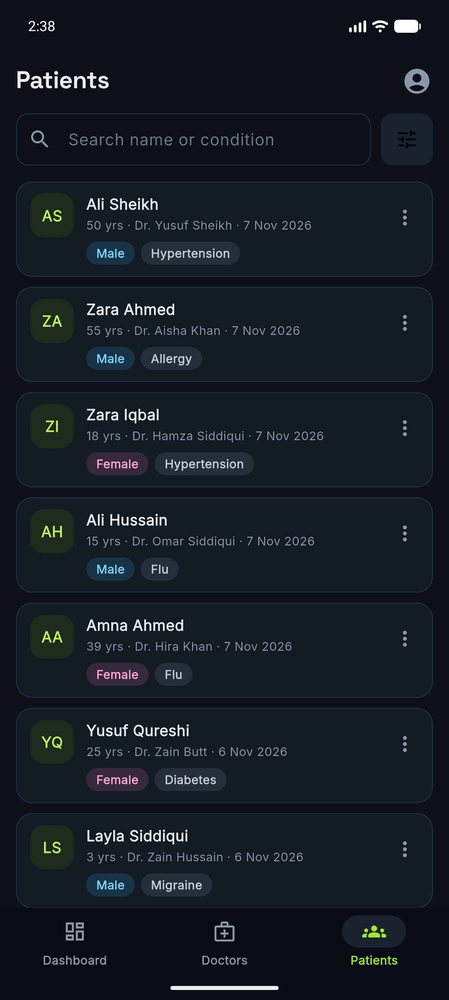</td>
  </tr>
</table>

## Visual evidence

Theme: **Midnight Lime**, a dark charcoal UI with a lime accent (Space Grotesk headings, Inter body).

**Login**

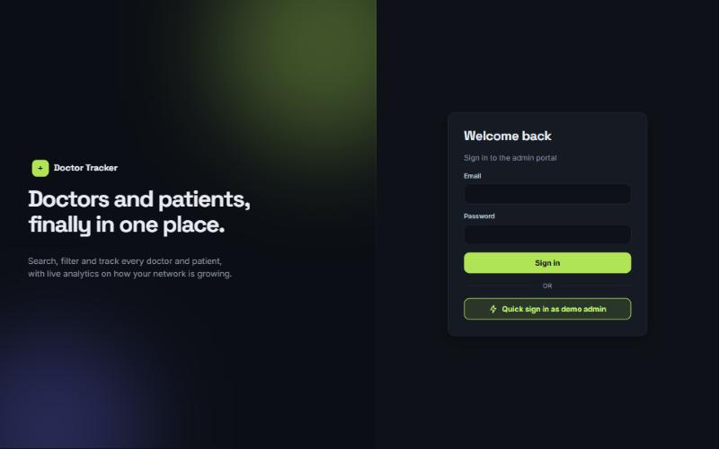

**Desktop**

| Dashboard | Doctors | Patients |
| --- | --- | --- |
| 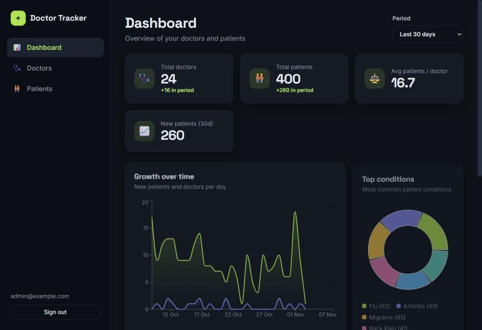 | 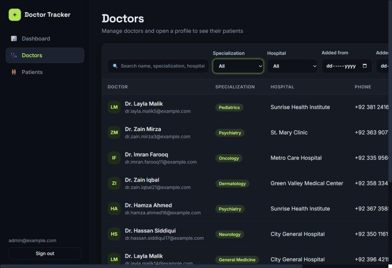 | 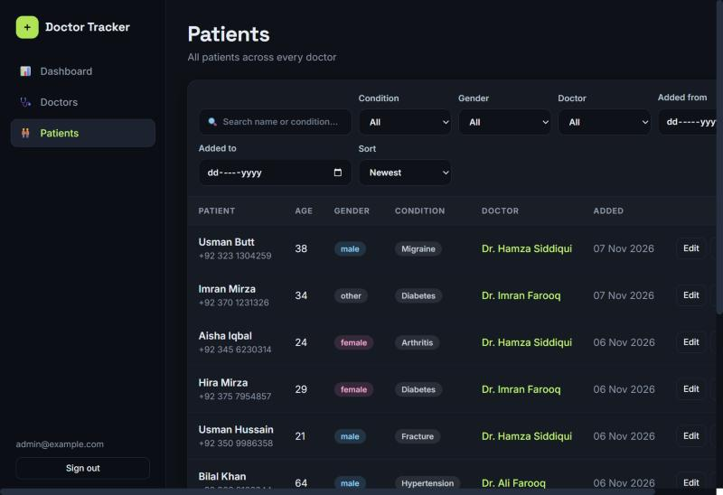 |

**Mobile**

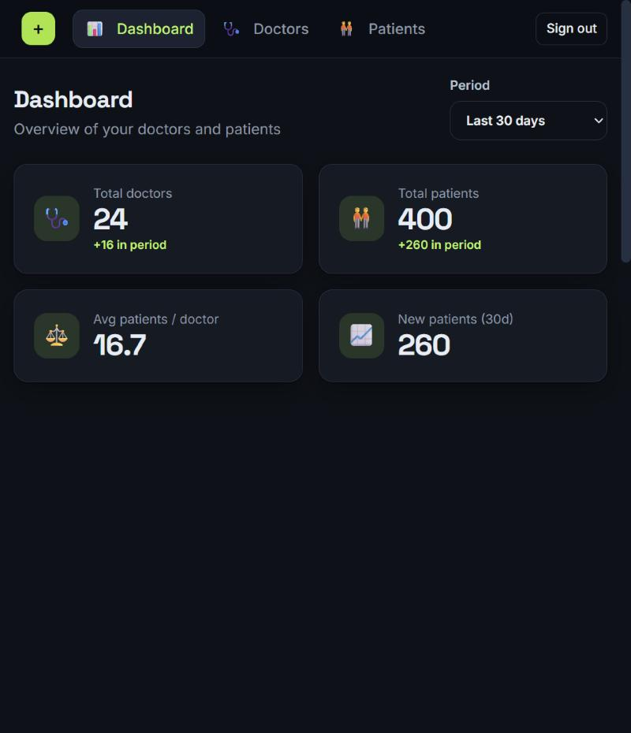
