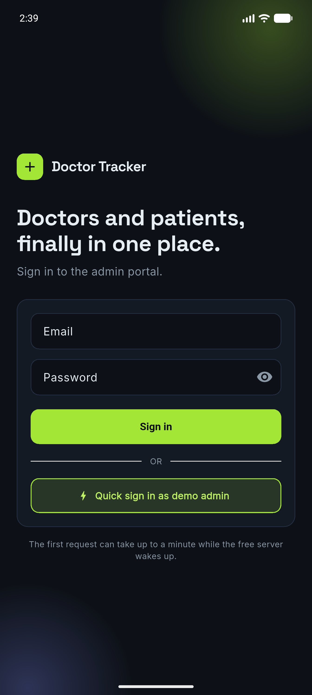
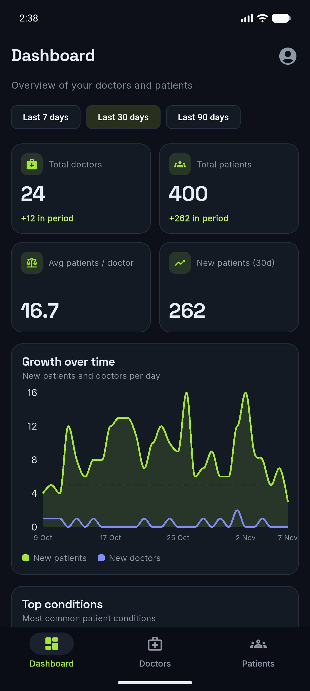
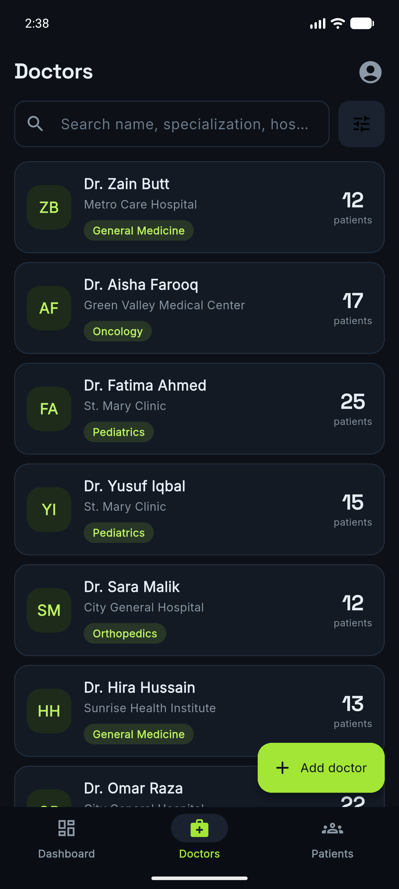
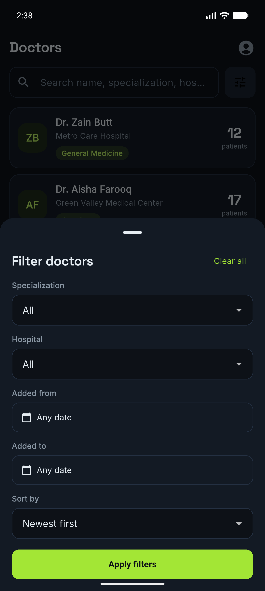
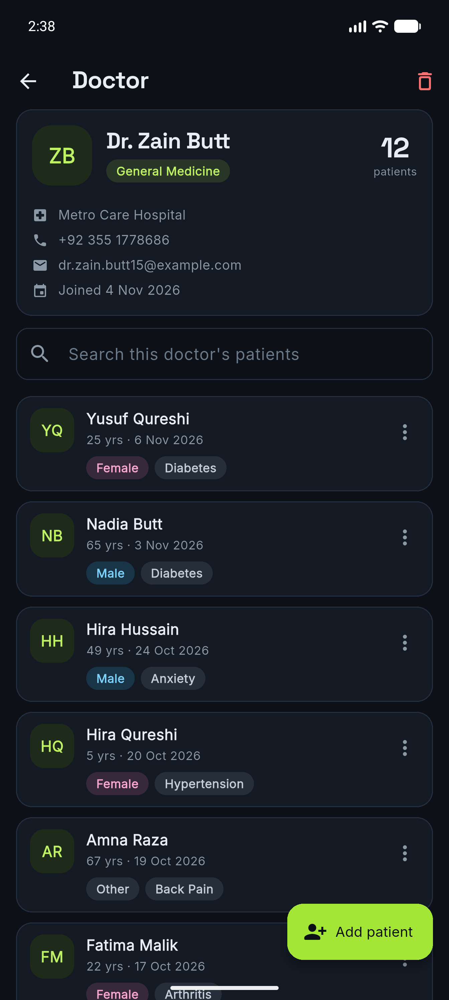
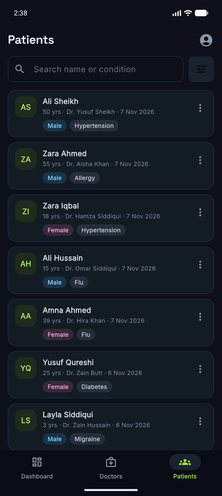

# Doctor Tracker: mobile app (Flutter)

Android / iOS (and desktop/web for testing) client for the Doctor Tracker REST API. It has the same features and the same **Midnight Lime** look as the web app: sign in, dashboard analytics, doctors, doctor profile with patients, and a patients list with search, filters, edit and delete.

<table>
  <tr>
    <td></td>
    <td></td>
    <td></td>
  </tr>
  <tr>
    <td></td>
    <td></td>
    <td></td>
  </tr>
</table>

## Run it

```bash
cd mobile
flutter pub get
flutter run                      # uses the live API on Render by default
```

Point it at another backend with `--dart-define`:

| Where the backend runs | Command |
| --- | --- |
| Local backend, Android emulator | `flutter run --dart-define=API_URL=http://10.0.2.2:4000` |
| Local backend, iOS simulator / desktop | `flutter run --dart-define=API_URL=http://localhost:4000` |
| Hide the demo button | `flutter run --dart-define=DEMO_MODE=false` |

Defaults live in `lib/config.dart`. The live API sleeps when idle, so the first request can take up to a minute.

Sign in with the admin account (`ADMIN_EMAIL` / `ADMIN_PASSWORD` from the backend) or tap **Quick sign in as demo admin** when the API runs with `DEMO_MODE=true`.

## Build

```bash
flutter build apk --release      # Android
flutter build ios --release      # iOS (on a Mac)
```

## How it is organised

```
lib/
  main.dart               app shell: splash -> login or home, by auth state
  config.dart             API URL and demo flag (compile-time)
  theme.dart              Midnight Lime colors, Material 3 theme, fonts
  models.dart             Doctor, Patient, DashboardStats, Paged<T>
  api/api_client.dart     REST client: Bearer token, error + field-error handling, 401 -> sign out
  state/auth_state.dart   sign in / demo / sign out, token saved on device
  state/paged_list.dart   reusable search + filter + infinite-scroll list state
  screens/                login, home (tabs), dashboard, doctors, doctor detail, patients
  widgets/                shared UI: lists, forms, filter sheet, patient tile
```

### Design notes

- **Auth:** the API returns a JWT, which the app sends as `Authorization: Bearer ...` (the web app uses an httpOnly cookie instead). The token is kept in `shared_preferences`; an expired token (401) signs the user out.
- **One list engine:** `PagedList<T>` handles search, filters, paging and stale-response protection for the doctors, patients and per-doctor lists. Screens only supply the fetch function and the item widget.
- **Performance:** server-side pagination (15 per page), debounced search (400 ms), tabs kept alive with `IndexedStack`, pull-to-refresh.
- **State management:** `provider` with `ChangeNotifier`. It's enough for this app, and the lists need no global store.
